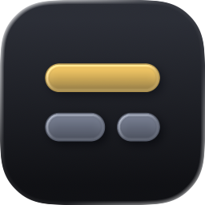

<p align="center"></p>

# Sublate

Native macOS app (SwiftUI front end, Rust core): paste a video URL, inspect its metadata with `yt-dlp`, download the video, translate a subtitle track into another language with Claude, or both. Subtitles are written as standalone `.srt` files — never merged into the video.

The name blends *subtitle* and *translate*, and it happens to be an English word too: to *sublate* (Hegel's *aufheben*) is to cancel something while preserving it at a higher level — which is what a translation does to the original line. The icon draws that: a broken source line below, lifted into one fluent translated line above.

## Install

Download the disk image, open it and drag **Sublate** to Applications. `ffmpeg` and the `deno` JavaScript runtime are inside the app; `yt-dlp` is not, so the first launch asks you to download it in **Settings (⌘,)**. It needs macOS 14 or later on Apple Silicon.

Translation uses your own Anthropic API key: paste it in **Settings (⌘,)**, where it is kept in your Keychain. Fetching and downloading work without one.

Sites change faster than the app ships, so `yt-dlp` is downloaded rather than bundled: **Settings → Download** fetches the latest official release, verifies its checksum, and installs it under `~/Library/Application Support/tech.radiw.sublate/`. After that the app looks for a newer release once a day, and **Settings → yt-dlp → Check for Updates** does the same on demand.

**Sublate → Check for Updates…** in the menu bar, or the same button under **Settings → Sublate**, asks GitHub for the latest release. When it is newer, **Install and Relaunch** downloads it, checks its checksum and that it is signed by the same developer, puts it in place of the running copy (which goes to the Trash), and opens the new version. The button waits while a download or translation runs. When the app cannot replace itself — it runs from the disk image, its folder is not writable for you, or the release has no archive — **Download…** opens the release page instead: download the disk image and drag **Sublate** to Applications again. The API key, the downloaded `yt-dlp` and the caches stay either way.

Moving the app to the Trash leaves that copy and the caches behind; **Settings → Clear Data** deletes them first. The API key has its own **Remove** button.

## Build

Requirements: macOS 26, Xcode 27, Rust from [rustup](https://rustup.rs) (not Homebrew's `rust`, whose standard library needs macOS 26), [XcodeGen](https://github.com/yonaskolb/XcodeGen) and [uv](https://docs.astral.sh/uv/) (`brew install xcodegen uv`), and a Developer ID Application certificate (`SIGN_IDENTITY` in the `Makefile`). uv runs the pinned [dmgbuild](https://dmgbuild.readthedocs.io) that lays out the disk image.

```sh
make run       # downloads and signs the bundled tools, builds the Rust core and the app, then opens it
make dmg       # signed disk image in dist/, for trying the installer on this Mac
make release   # the same, notarized and stapled, plus the zip of the app: the files to publish
```

`make release` needs notarization credentials stored once:

```sh
xcrun notarytool store-credentials sublate --apple-id <apple id> --team-id <team id>
```

A release is published on GitHub under the tag `v<version>`, where the version is `MARKETING_VERSION` in `app/project.yml`. The app's update check reads the latest release and rejects a tag of any other form. Publish both files: the app installs updates from `Sublate-<version>.zip`, verified against the sha256 digest GitHub records for it; without it, users get the release page. Keep the disk image read-only (`format` in `scripts/dmg.settings.py`): the app refuses to replace itself only because it cannot write there.

```sh
gh release create v0.4.0 dist/Sublate-0.4.0.dmg dist/Sublate-0.4.0.zip
```

`make project` alone produces `app/Sublate.xcodeproj` for working in Xcode; rerun `make core` after changing Rust code.

The bundled tools are pinned by version and checksum in `vendor/tools.lock`; `make tools` rebuilds `vendor/tools` after a change there. Their licences are listed in `vendor/licenses/README.md` and ship inside the app.

Developers can skip the saved key: without one, the app falls back to `ANTHROPIC_API_KEY` from the login shell, then to a token from the `ant` command line tool. The `ant` profile is the one named in Settings, else the one named by `ANTHROPIC_PROFILE`, else the profile that is active in `ant`.

## Layout

| Path | Content |
| --- | --- |
| `core/` | Rust crate: yt-dlp and its updater, subtitle parsing, Claude translation. `src/ffi.rs` is the only surface the UI sees, exported through [UniFFI](https://mozilla.github.io/uniffi-rs/). |
| `app/Kit/` | Swift package: `SublateCore` (generated bindings over the static library) and `SublateUI` (view model and SwiftUI views). |
| `app/Sublate/` | The app shell; `app/project.yml` is the XcodeGen spec. |
| `app/Sublate/Resources/AppIcon.icon` | The app icon, an [Icon Composer](https://developer.apple.com/icon-composer/) document that Xcode compiles for every size and appearance; `make icon` renders `docs/icon.png` from it for this README. |
| `vendor/` | Pinned third-party tools (`ffmpeg`, `deno`): `fetch.sh` downloads, verifies and signs them into `vendor/tools`, which the app bundles as `Contents/Resources/tools`. |
| `scripts/package.sh` | Builds, signs and optionally notarizes the disk image; `dmg.settings.py` is its drag-to-Applications window layout. |

## Output

Each video gets its own folder in `~/Downloads/Sublate/` by default (or the folder chosen under **Save to**). The folder and its files are named `<title> [<id>]` so same-titled videos never collide (reserved characters such as `? / : $` become full-width look-alikes; the id alone is used if the title is empty). Long titles are shortened so every name stays within 255 bytes in decomposed (NFD) UTF-8, the limit Synology Drive enforces:

| File | Content |
| --- | --- |
| `<title> [<id>].mp4` | Best-quality streams, up to the chosen **Resolution**, copied into mp4 (no re-encode) with the YouTube thumbnail as cover art, so Finder/Quick Look previews show it; no embedded subtitles. AV1 videos need VLC or IINA. |
| `<title> [<id>].<src>.srt` | Source subtitle as downloaded (e.g. `ko-orig`) |
| `<title> [<id>].<target>.srt` | Translated subtitle (e.g. `zh-TW`; `.<target>.translated.srt` when source and target codes match) |

YouTube auto-captions scroll (each cue repeats the previous line); the translated file collapses them into clean, non-overlapping cues. Translation uses `claude-sonnet-5-5` (effort `medium`); Chinese and Japanese output is post-processed so half-width punctuation next to CJK text becomes full-width.

## Tests

```sh
make test                                                                         # offline: Rust core + Swift view models
cargo test --manifest-path core/Cargo.toml --test live_test -- --ignored --nocapture  # hits YouTube, GitHub + Claude API
LIVE=1 swift test --package-path app/Kit                                           # same through the Swift bridge, plus the Keychain and the update signature check
```

The live tests run the vendored tools (`make tools`), the same binaries the app ships. The Swift live tests also need `make build` first: they check that the update signature check accepts that Developer ID build and rejects it for another team or bundle identifier.

## License

Copyright (C) 2026 YingPing Lin

Sublate is free software: you can redistribute it and/or modify it under the terms of the GNU General Public License as published by the Free Software Foundation, either version 3 of the License, or (at your option) any later version. It is distributed without any warranty; see [`LICENSE`](LICENSE) for the full text.

The bundled tools stay under their own licences, listed in [`vendor/licenses/README.md`](vendor/licenses/README.md).

The name "Sublate" and the app icon are trademarks of YingPing Lin and are not licensed under the GPL. Forks and modified builds must use a different name and icon.
